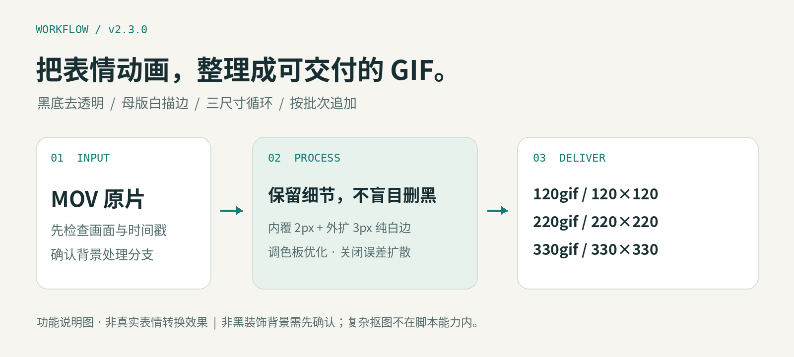
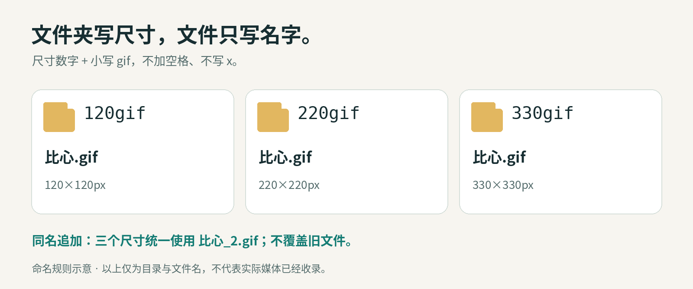

<div align="center">

# 表情包转 GIF · Claude Skill

**MOV 表情包 → 去黑底 · 纯白描边 · 三尺寸循环 GIF**

`v2.3.0` · `120gif / 220gif / 330gif` · `中文文件名` · `安全追加`

[下载技能包](dist/表情包转GIF_v2.3.skill.zip) · [快速开始](#快速开始) · [命名规则](#命名规则) · [常见问题](#常见问题)

</div>



## 这是什么？

这是一个面向 **Claude Skill 工作流**的 MOV 表情包转换工具，包含完整的技能说明和可独立运行的 Python 参考脚本。它不是网页在线转换站，也不只是一个提示词。

针对常见的**均匀黑底表情动画**，它去除与画布边缘连通的黑色背景，尽量保留角色内部的黑色眼睛、墨镜与线条；在原尺寸母版上添加纯白描边，再分别生成三种尺寸的循环 GIF。对非黑色装饰背景，先确认保留还是另做精细分割，不把所有素材一股脑送进黑底抠图。

> **先看背景，再转换。** 脚本本身不会识别背景类型；未加 `--preserve-background` 的输入都会走去黑底流程。复杂背景不是这个脚本的通用自动抠图能力。

## 功能一览

| 能力 | 具体规则 |
| --- | --- |
| 去黑底 | 只去除连接画布边缘的近黑区域，不做全图删黑 |
| 白描边 | 原尺寸母版内覆 2px、外扩 3px，总宽 5px；之后随画面缩放 |
| 尾帧清理 | 黑底分支只裁最后有效画面之后连续空帧，不固定删除某段时长 |
| 三尺寸输出 | 120×120、220×220、330×330；等比缩放、透明补方，不拉伸 |
| 动画时序 | 保留正常速度、无限循环；累计时间量化至 GIF 的 10ms 精度 |
| 颜色处理 | 全局调色板、`kmeans=3` 优化、关闭误差扩散，避免此前发现的零散暗色噪点 |
| 中文名称 | 如 `120gif/比心.gif`；不在文件名里重复加尺寸 |
| 安全追加 | 同名时三个尺寸统一加序号，不覆盖旧文件，不自动迁移旧库 |
| 每批交付 | 新增 GIF、JSON 处理报告、本批独立 ZIP；不混入以前的成品 |
| 编码验证 | 重新解码检查尺寸、循环、时序、透明、白边和编码像素；复制校验 SHA256，ZIP 检查 CRC |

## 实际效果与配图

**当前文档包含功能概览、背景分流、目录命名三张说明图，不是实际表情的转换前后对比。** 真实 MOV/GIF 尚未纳入此仓库包，历史测试中提到的素材也没有随代码公开。

计划采用以下方式展示获得公开许可的真实素材：

| 素材 | 在 README 中如何展示 | 目的 |
| --- | --- | --- |
| GIF 成品 | Markdown 直接嵌入，保留动画 | 看动作、透明边缘、循环效果 |
| MOV 原片 | 点击封面图进入文件页或下载原片 | 保留原始输入，便于对照 |
| 三尺寸 GIF | 并排或逐行展示，标注真实像素 | 对比不同尺寸的清晰度 |
| 透明检查图 | 把同一帧合成在白/灰/深底上 | 检查描边、残留黑边或粉边 |

GitHub README 不应依赖任意 `<video>` 标签或仓库 MOV 自动内嵌播放。稳妥方案是 **GIF 动画 + MOV 封面/下载链接**。若需要视频播放器，可另外使用 GitHub 支持的媒体附件方式，实际支持以平台与编码格式为准。详见 [真实素材展示指南](docs/MEDIA.md)。

## 背景处理规则


### A. 均匀黑底 → 透明背景 + 白描边

1. 去掉外部连通的近黑背景，尽量保留主体内部黑色细节。
2. 裁掉末尾连续纯背景/全透明帧，保留正常动作、静止姿势和中段留白。
3. 在原尺寸母版上加 5px 纯白描边：内覆 2px、外扩 3px，遮住外轮廓处的少量粉边。
4. 从同一母版分别输出三尺寸 GIF。不是在每个成品上再加固定 5px 白边。
5. 量化后锁定描边为纯白，使用单独的透明索引与正确的帧处置方式，减少残影。

若主体贴边，整段统一补透明边距再描边，避免逐帧缩放抖动。已经在原视频中被裁掉的部分不会自动补造。

### B. 非黑色装饰背景 → 先确认

- **确认保留**：不抠图、不描边、不自动裁尾，按三尺寸输出。原画面不透明；非正方形素材仅补边可能透明。
- **要求去除**：需要另做精细分割与遮罩检查。参考脚本**不能自动去除任意装饰背景**，不能用黑底阈值假装完成。
- **尚未确认**：不要把这类素材放进默认黑底分支。Claude 应先展示/描述背景差异，再询问用户。

## 快速开始

### 方式一：作为 Claude Skill 使用

1. 下载本仓库的 [v2.3 技能安装包](dist/表情包转GIF_v2.3.skill.zip)。这是专用技能包，不是 GitHub 的“Download ZIP”源码包。
2. 在支持自定义技能 ZIP 导入的 Claude 环境中，打开技能管理入口并导入。具体入口取决于产品、版本及账户设置。
3. 如已存在同名旧版本，用此包替换或停用旧版本，避免重复启用。
4. 确认技能目录包含 `SKILL.md` 和 `scripts/convert_stickers.py`，脚本 `VERSION` 应为 `2.3.0` 或更高。
5. 上传 MOV 后，让 Claude 先检查背景，再按工作流转换。技能导入不会自动安装 FFmpeg 和 Python 库，执行环境必须具备相应能力和依赖。

可以这样说：

> 把这些 MOV 表情包转成三尺寸 GIF。黑底去透明并加白描边，非黑装饰背景先问我。沿用现有成品根目录，文件夹用 120gif、220gif、330gif，文件名只保留表情名；本批单独打包，不覆盖旧文件。

混合背景的情况：

> 这个表情保留原装饰背景，其他黑底表情去背景；不要把保留背景的结果标成透明 GIF。

安装包外面的 ZIP 文件名可以用中文；请不要随意改内部 `SKILL.md`、技能标识或脚本路径。

### 方式二：直接运行 Python 脚本

下面命令适用于 macOS / Linux 的终端，路径请替换为实际路径。Windows 可使用等价环境，但本仓库未声明已验证所有 Windows 配置。

**安装依赖**（建议用独立虚拟环境）：

```bash
# macOS：如果还没有 FFmpeg，并且已自行安装 Homebrew
brew install ffmpeg

# Debian / Ubuntu：改用系统包管理器安装
# sudo apt-get update && sudo apt-get install ffmpeg

python3 -m venv .venv
source .venv/bin/activate
python -m pip install -r requirements.txt

ffprobe -version
python -I scripts/convert_stickers.py --help
```

只需选择适合系统的 FFmpeg 安装方式，不必都执行。`requirements.txt` 只列出 Python 依赖，不会安装 FFmpeg。

**处理已确认的黑底素材：**

```bash
python -I scripts/convert_stickers.py \
  --output-root "/实际路径/POPO表情包GIF_修复版" \
  --batch-id "批次_新增_001" \
  "/实际路径/原片/比心.mov" \
  "/实际路径/原片/加油.mov"
```

**混合处理：某个素材已确认保留装饰背景：**

```bash
python -I scripts/convert_stickers.py \
  --output-root "/实际路径/POPO表情包GIF_修复版" \
  --batch-id "批次_混合_002" \
  --preserve-background "/实际路径/原片/对的对的.mov" \
  "/实际路径/原片/比心.mov" \
  "/实际路径/原片/对的对的.mov"
```

`--preserve-background` 可以重复；其路径**必须也在输入列表中出现**。显式传 MOV 文件，不传文件夹，也不要重复传同一文件。

从已核对的干净代码目录运行，不要切到上传附件或未知解压目录中运行解释器。`python -I` 开启隔离模式，减少当前目录或环境变量引入同名模块的风险。

## 命令行参数

| 参数 | 是否必需 | 说明 |
| --- | --- | --- |
| `inputs` | 是 | 一个或多个现有 `.mov` 文件；扩展名不区分大小写 |
| `--output-root` | 是 | 新建或已有成品根目录，之后批次复用此目录 |
| `--batch-id` | 否 | 唯一批次名；不传时生成含微秒的 UTC 时间戳名；不能覆盖已有批次 |
| `--preserve-background` | 否，可重复 | 已经人工确认保留背景的输入；不抠图、不描边、不自动裁尾 |
| `--threshold` | 否 | 近黑阈值，默认 `96`，合法范围 `0–200`；须抽帧核对，不要机械提高 |

脚本没有“自动识别复杂背景”或“任意复杂背景抠图”参数。

## 命名规则



```text
成品根目录/
├── 120gif/
│   ├── 比心.gif
│   └── 比心_2.gif
├── 220gif/
│   ├── 比心.gif
│   └── 比心_2.gif
├── 330gif/
│   ├── 比心.gif
│   └── 比心_2.gif
└── batches/
    ├── 批次_新增_001/
    │   ├── 处理报告.json
    │   └── 批次_新增_001_三尺寸GIF.zip
    └── 批次_混合_002/
        ├── 处理报告.json
        └── 批次_混合_002_三尺寸GIF.zip
```

- 文件夹固定为 **尺寸数字 + 小写 `gif`**：`120gif`、`220gif`、`330gif`。不加空格、不写 `x`、不写乘号。
- `比心.mov` → 三个文件夹中的 `比心.gif`。文件名不再使用 `比心_120x120.gif`。
- 同名冲突在所有尺寸之间统一预留名称，例如三个尺寸都是 `比心_2.gif`；并做大小写不敏感的名称检查。
- 中文名称可以直接使用；路径中的非法字符会替换为 `_`，空白或不安全名称会拒绝。
- 旧的 `120x120/`、`120x120gif/` 等目录仍参与防重名检查，但脚本不再向其写入，不自动移动、重命名或删除旧文件。
- 向同一个根目录追加，不要每批都新建一套成品库。**不要并发运行多个实例写入同一输出根目录。**

## 批次 ZIP 与处理报告

每批 ZIP 只包含本批新生成的三尺寸 GIF，以及 `处理报告.json`、`说明.txt`。压缩包内部目录仍为 `120gif/`、`220gif/`、`330gif/`，不会把过去的成品再次打进去。

报告包含：

- 技能版本、批次名、三尺寸及文件夹映射；
- 原文件名、背景分支、原始尺寸/帧数、保留帧数、去尾帧数与时长；
- 黑底阈值、母版描边宽度与补边信息；
- 每个成品的相对路径、尺寸、帧数、总时长、大小、循环标记、校验状态和 SHA256。

所有 GIF 先在独立暂存目录转换和验证，再复制到成品库。文件用排他创建以防覆盖，复制后核对校验值。**这不等于文件系统事务**：若复制或打包阶段发生断电、磁盘满等故障，可能留下已追加文件或不完整批次；请先核对状态并备份，再换新批次 ID 重试，不要盲目删除旧文件。

## 质量检查与测试

数值验证不代替视觉检查。建议至少检查：

- 眼睛、墨镜、手、小爱心、星星等是否完整；
- 白/灰/深背景上的边缘是否有粉线、黑边、残影、截断或闪烁；
- 放大渐变区域，看是否出现原片不存在的零散黑点；
- 尾部是否误删有效画面，速度和循环是否自然；
- 保留装饰背景的成品是否被正确标记为非透明原画面。

[TESTS.md](TESTS.md) 保留版本对应的测试记录：v2.3 用两段合成 MOV 检查路径/追加/防重名，并与 v2.2 的 6 个对应 GIF 做逐字节比较；六个真实 MOV 的结果属于早期版本的历史记录，不是本次文档整理中重新执行的测试，也不是“所有素材都适用”的保证。

本仓库额外包含命名单元测试，可在安装依赖后运行：

```bash
python -I -m unittest discover -s tests -v
```

它验证文件名、目录和防覆盖行为，不替代完整 MOV 转换或人工视觉验收。

## 常见问题

**可以用中文文件名吗？**  
可以。输入、输出和外层安装 ZIP 都可以用中文。示例：`120gif/太强了.gif`。内部技能标识保留 `mov-sticker-to-transparent-gif`，规范入口保留 `SKILL.md`。

**为什么白边不是三个尺寸都一样粗？**  
5px 白边定义在原尺寸母版上，之后随画面等比缩放，这是设计规则，不是遗漏。不要给每个成品再单独加 5px。

**提高 GIF 尺寸能消除黑点吗？**  
不能解决旧版颜色量化导致的噪点。v2.1 改为优化全局调色板并关闭 Floyd–Steinberg 误差扩散，v2.3 保留该修复；这不保证所有源片的压缩噪声都能自动消失。

**有透明索引，为什么看起来仍有背景？**  
确认保留背景的分支保留原画面。GIF 含有透明索引，不等于实际画面中一定存在透明像素；透明棋盘格也只是查看器的显示方式。

**会去掉角色的黑眼睛吗？**  
算法尽量保留不与外部黑底连通的黑色细节；若细节连到外部，或背景形成封闭孔洞，仍可能误判，须人工检查或精细分割。

**可以处理 MP4、长视频或任意复杂背景吗？**  
当前 CLI 只接受 MOV。短表情动画是主要场景，脚本在内存中处理全部帧；长视频、大分辨率可能耗尽内存。任意复杂背景分割、HDR、旋转元数据和特殊色彩转换不属于当前自动保证范围。

**提示帧延迟小于 20ms / 时间戳异常？**  
脚本会停止提示，不会悄悄改变速度。先确认源片时间戳、帧率和时长，再合理标准化并保持总时长；不要只靠改 GIF delay 硬凑。

**旧目录会自动换成新名字吗？**  
不会。旧库仅读取防重名，新输出进入规范目录。整体迁移需要单独检查冲突、更新报告与 ZIP，不能仅改目录名后声称全部历史记录已同步。

**README 可以直接放 MOV 动画吗？**  
GIF 可直接嵌入；MOV 建议用封面图链接到文件页/下载。仓库中的 MOV 文件不能被当作 README 内必然自动播放的视频。详见 [媒体指南](docs/MEDIA.md)。

## 仓库文件

```text
mov-sticker-to-transparent-gif/
├── README.md                       # 面向使用者的详细说明
├── SKILL.md                        # Claude 技能入口，v2.3.0
├── scripts/convert_stickers.py      # 转换脚本，v2.3.0
├── requirements.txt                # Python 运行依赖
├── CHANGELOG.md                    # 版本记录
├── TESTS.md                        # 随技能保留的历史/回归记录
├── 使用说明.md                     # 原技能包说明
├── dist/表情包转GIF_v2.3.skill.zip    # 专用技能安装包
├── docs/assets/                    # 原创说明图，不是实际转换效果
├── docs/MEDIA.md                   # 真实 GIF/MOV 公开展示指南
├── docs/PUBLISH.md                 # GitHub 新建/上传/发布指南
├── docs/VERIFICATION.md            # 此次仓库整理的核对记录
├── examples/README.md              # 演示素材状态；当前不含原片
├── tests/test_naming.py            # 命名、防覆盖单元测试
└── tools/package_skill.py          # 重新生成专用技能 ZIP
```

## 更新与重新打包

最新功能变更见 [CHANGELOG.md](CHANGELOG.md)。v2.3 的主要变化是文件夹固定为 `120gif/220gif/330gif`；v2.2 确立仅用表情名；v2.1 修复量化黑点。

```bash
python -I tools/package_skill.py
```

该命令从规范的五个技能文件生成 `dist/表情包转GIF_v2.3.skill.zip`，排除 `.DS_Store`、测试临时文件、私有原片、仓库文档和 `.git`。完整源码仓库 ZIP 与技能安装 ZIP 用途不同，导入技能时使用 `dist` 内的专用包。打包工具为防止误覆盖，若目标 ZIP 已存在会拒绝；需要重新打包时，先自行备份并移走已有 ZIP，再运行。

## 公开发布与授权

仓库：[AeroL1n/mov-sticker-to-transparent-gif](https://github.com/AeroL1n/mov-sticker-to-transparent-gif)。创建和后续更新步骤见 [GitHub 发布指南](docs/PUBLISH.md)。本仓库公开提供技能源码、专用安装包和中文说明；真实 MOV/GIF 演示素材尚未纳入，GitHub Release 尚未单独建立。

当前未附带开源许可证；**公开可见不等于已授予任意修改、再分发或商用许可**。如需开放这些权利，由维护者选择适当许可证后再添加，不擅自替作者决定授权条款。

真实表情、角色形象、MOV 原片及 GIF 成品可能涉及独立权利。仅发布有权公开的素材，说明图与演示素材应分开标注。请勿将凭证、私人源片或本机个人路径提交到公开仓库。
